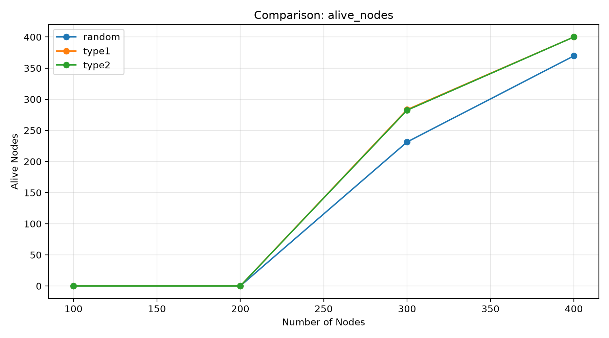
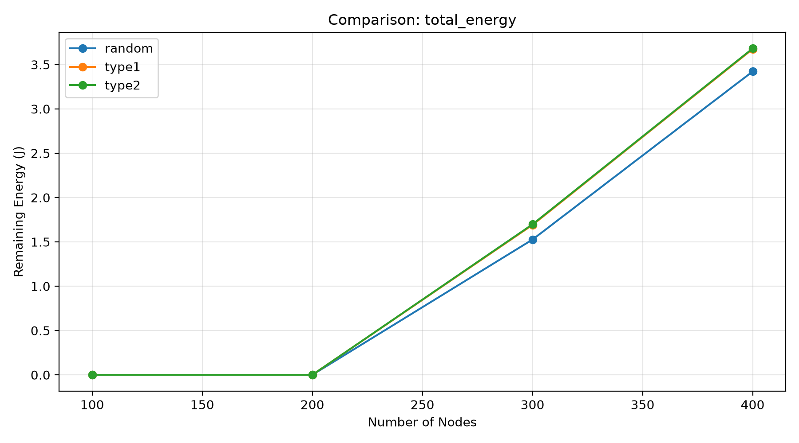
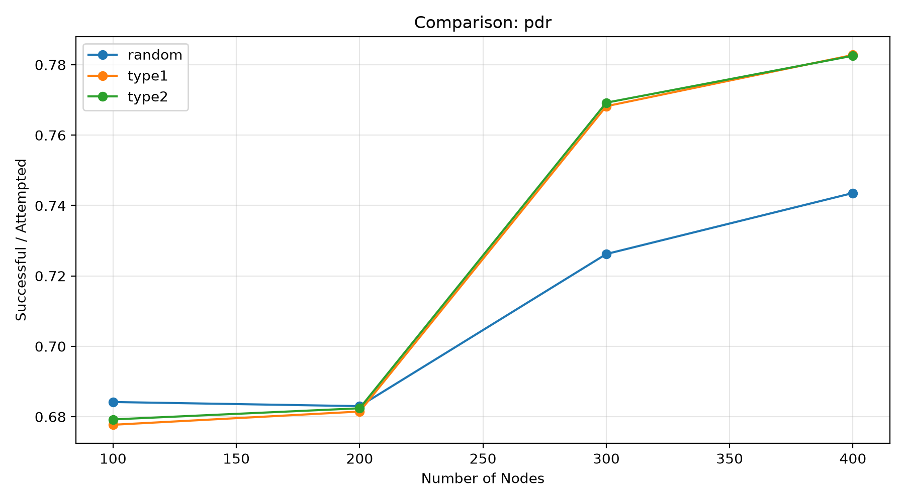

# Secure and Energy-Efficient Routing in Wireless Sensor Networks Using Type-2 Fuzzy Logic

## 1. Introduction

Wireless Sensor Networks (WSNs) consist of sensor nodes that collect and transmit data. Since these nodes typically operate with limited battery capacity, energy-efficient routing is essential for extending network lifetime.

Routing decisions must also consider transmission delay and node reliability. Selecting a node solely based on energy consumption may lead to unreliable communication.

This project investigates fuzzy logic-based routing for WSNs, inspired by the reference study *A secure and energy-efficient routing using coupled ensemble selection approach and optimal type-2 fuzzy logic in WSN*.

The project implements a simplified Interval Type-2 Fuzzy Logic System (IT2FLS) and compares its performance against Type-1 fuzzy logic and random node selection.

## 2. Reference Study and Literature Background

### 2.1 Reference Study

Ambareesh et al. (2025) proposed a secure and
energy-efficient routing framework for Wireless
Sensor Networks (WSNs).

Their framework combines three major components:

1. Weighted consensus clustering and coupled
   ensemble selection for cluster formation.
2. Improved Type-2 Fuzzy Logic System (IT2FLS)
   for routing decisions under uncertainty.
3. Reptile Search Algorithm (RSA) for optimizing
   fuzzy system parameters.

The proposed routing framework considers energy
consumption, communication delay, and dynamic
trust to improve network lifetime, packet delivery,
and communication reliability [1].

### 2.2 Related Literature

Guleria et al. investigated energy-efficient
clustering to reduce sensor energy consumption
and extend network lifetime [2].

Mittal et al. investigated an energy-efficient
clustering approach combining fuzzy logic and
the flower pollination algorithm to improve
cluster-head selection in WSNs [3].

Abu Salem et al. studied an enhanced LEACH-based
protocol for improving energy management and
network lifetime [4].

These studies demonstrate that clustering,
energy-aware routing, and fuzzy decision-making
are important approaches to improving WSN
performance.

### 2.3 Scope of the Reproduction

The original framework contains multiple
interconnected components. Reproducing the
complete architecture would require clustering,
optimization, dynamic security assessment, and
multihop communication.

This project instead implements a simplified
Interval Type-2 fuzzy node-selection subsystem.

The implemented subsystem uses energy cost,
distance-based delay, and trust as fuzzy inputs.

A Type-1 fuzzy baseline and a random-selection
baseline were implemented for comparative
evaluation.

The purpose is to investigate the effect of
interval-valued fuzzy membership functions
within a controlled simulation environment,
rather than reproduce the original paper's
complete experimental results.

## 3. Methodology

### 3.1 Network Simulation

A simplified wireless sensor network was implemented using Python and NumPy.

The simulation parameters were:

- Network area: 400 × 400 m²
- Sink position: (200, 200)
- Number of nodes: 100, 200, 300, and 400
- Initial node energy: 0.02 J
- Maximum simulation rounds: 3000
- Random seeds: 42, 43, and 44

Nodes were randomly distributed across the network area.

Each node was assigned an initial trust value between 0.5 and 1.0.

### 3.2 Routing Inputs

Three normalized routing inputs were used:

**Energy cost:**

$$
C_E = 1-\frac{E_{\mathrm{remaining}}}{E_{\mathrm{initial}}}
$$

This metric represents the fraction of energy already
consumed by a sensor node.

**Delay proxy:**

$$
D = \min\left(
\frac{d_{\mathrm{sink}}}{400\sqrt{2}},1
\right)
$$

This value is derived from the distance between
the sensor node and the sink. It is a simplified
distance-based proxy, not a measurement of actual
packet transmission delay.

**Trust:**

Each node is assigned a static trust value in
the interval [0.5, 1.0].

For each transmission, a random number is generated.
The packet is considered successfully delivered if
the random number is smaller than the node's trust
value.

Trust is therefore modeled as a delivery probability
rather than calculated from observed node behavior.

### 3.3 Interval Type-2 Fuzzy Logic

The implemented Type-2 fuzzy system uses upper and lower triangular membership functions.

Each input is represented using three linguistic labels:

- Low
- Medium
- High

The interval between the upper and lower membership functions represents uncertainty in membership values.

A total of 27 fuzzy rules were generated from the combinations of three inputs and three linguistic labels.

The routing score combines energy efficiency, low delay, and high trust using the weights:

- Energy: 0.35
- Delay: 0.25
- Trust: 0.40

These weights and the complete 27-rule configuration are implementation assumptions, not parameters claimed to be identical to the reference paper.

### 3.4 Mathematical Formulation

**Triangular Membership Function**

The triangular membership function is defined as:

$$
\mu(x;a,b,c)=
\begin{cases}
0, & x\leq a\\
\frac{x-a}{b-a}, & a<x<b\\
1, & x=b\\
\frac{c-x}{c-b}, & b<x<c\\
0, & x\geq c
\end{cases}
$$

**Interval Type-2 Membership**

Each linguistic term is represented by lower and
upper membership functions:

$$
\underline{\mu}(x)\leq\overline{\mu}(x)
$$

The interval between these functions represents
uncertainty in membership degree.

**Rule Firing Strength**

For each fuzzy rule, the minimum t-norm is used:

$$
\underline{f}_i =
\min(\underline{\mu}_{i1},
\underline{\mu}_{i2},
\underline{\mu}_{i3})
$$

$$
\overline{f}_i =
\min(\overline{\mu}_{i1},
\overline{\mu}_{i2},
\overline{\mu}_{i3})
$$

**Type Reduction and Defuzzification**

The Interval Type-2 system uses the Karnik-Mendel
iterative algorithm to calculate the output interval:

$$
[y_L,y_R]
$$

The final crisp routing score is:

$$
S=\frac{y_L+y_R}{2}
$$

**Energy Consumption Model**

The simplified transmission energy cost is:

$$
E_{tx}(d)=0.001+2\times10^{-8}d^2
$$

where $d$ represents the distance between the
transmitting node and the sink.

**Packet Delivery Ratio**

$$
PDR=\frac{N_{\mathrm{successful}}}
{N_{\mathrm{attempted}}}
$$

These equations describe the implemented
experimental model. They do not represent a
complete reproduction of the reference paper.

### 3.5 Comparison Methods

**Type-1 Fuzzy Baseline**

For the Type-1 baseline, each membership degree is
calculated as the midpoint of the corresponding
Interval Type-2 membership bounds:

$$
\mu_{T1}(x)=
\frac{\underline{\mu}(x)+\overline{\mu}(x)}{2}
$$

The firing strength of each rule is calculated using
the minimum t-norm.

The final Type-1 routing score is calculated using
a weighted average of the rule consequents:

$$
S_{T1}=
\frac{\sum_{i=1}^{27} f_i c_i}
{\sum_{i=1}^{27} f_i}
$$

where $f_i$ is the firing strength and $c_i$ is
the consequent value of rule $i$.

This baseline uses the same rule base as the
Interval Type-2 method to enable a controlled
comparison.

Three routing strategies were evaluated:

1. **Random:** Randomly selects an alive node.
2. **Type-1:** Uses conventional fuzzy membership values.
3. **Type-2:** Uses interval Type-2 membership values.

All three strategies were evaluated under the same node counts and random seeds.

## 4. Experimental Evaluation

A total of 36 experimental configurations were evaluated:

4 node counts × 3 random seeds × 3 routing methods.

The following metrics were recorded:

- Remaining alive nodes
- Total remaining energy
- Packet Delivery Ratio (PDR)
- First Node Death (FND)
- Half Node Death (HND)
- Last Node Death (LND), where reached

PDR was calculated as the ratio of successful transmissions to attempted transmissions.

FND, HND, and LND represent the simulation rounds at which the first node, half of the nodes, and all nodes have died, respectively.

## 5. Results and Discussion

### Experimental Results Summary

The following table presents the average results obtained
from three random seeds (42, 43, 44) for each method.

| Nodes | Method | Remaining Energy (J) | PDR |
|---|---|---|---|
| 100 | Random | 0.000 | 0.684 |
| 100 | Type-1 | 0.000 | 0.678 |
| 100 | Type-2 | 0.000 | 0.679 |
| 200 | Random | 0.000 | 0.683 |
| 200 | Type-1 | 0.000 | 0.681 |
| 200 | Type-2 | 0.000 | 0.682 |
| 300 | Random | 1.526 | 0.726 |
| 300 | Type-1 | 1.691 | 0.768 |
| 300 | Type-2 | 1.697 | 0.769 |
| 400 | Random | 3.422 | 0.744 |
| 400 | Type-1 | 3.675 | 0.783 |
| 400 | Type-2 | 3.681 | 0.783 |

### 5.1 Energy Consumption

The results indicate that fuzzy logic-based node selection generally preserved more remaining energy than random node selection, particularly in networks containing 300 and 400 nodes.

At 100 and 200 nodes, all nodes had exhausted their energy by the end of the simulations.

### 5.2 Packet Delivery Ratio

At higher node counts, Type-1 and Type-2 fuzzy routing achieved higher packet delivery ratios than random selection.

For 300 and 400 nodes, the fuzzy routing strategies produced similar PDR values, with differences depending on the random seed.

### 5.3 Network Lifetime

The experiments recorded FND, HND, and LND to evaluate network lifetime.

Fuzzy routing generally delayed the first node death compared with random selection in the tested configurations where node death occurred.

However, the simplified simulation did not demonstrate a consistent superiority of Type-2 over Type-1 fuzzy routing.

### 5.4 Interpretation

The results suggest that considering energy, delay, and trust jointly can improve routing decisions compared with random selection.

Nevertheless, the performance differences between Type-1 and Type-2 were relatively small.

Therefore, the experimental evidence supports the usefulness of fuzzy routing in this simplified environment but does not establish that Type-2 fuzzy logic is universally superior.

### 5.5 Experimental Results: Figures

**Figure 1. Remaining alive nodes**

**Figure 2. Remaining network energy**

**Figure 3. Packet Delivery Ratio (PDR)**

## 6. Original Contribution

The project's independent contribution is a controlled comparative implementation of three node-selection strategies within a common simulation environment.

The implementation includes:

- Configurable WSN simulation
- Type-1 and Interval Type-2 fuzzy routing
- A rule-based routing score incorporating energy, delay, and trust
- Reproducible experiments using fixed random seeds
- Automated CSV result generation and comparative visualizations
- Network lifetime measurements

The work constitutes a simplified reproduction and comparative extension of the reference study's fuzzy routing subsystem rather than a complete reproduction of its entire architecture.

## 7. Limitations

The following limitations must be considered:

1. The original paper's complete clustering and ensemble selection framework was not implemented.
2. Reptile Search Algorithm optimization was not reproduced.
3. Energy consumption and transmission delay were modeled using simplified equations.
4. Node trust was simulated rather than derived from a full security or attack-detection mechanism.
5. The fuzzy rule weights and membership parameters were selected for this implementation.
6. Only three random seeds were used for each node count.
7. The simulation selects one transmitting node per round, which does not reproduce a complete multihop WSN communication protocol.

These limitations prevent direct quantitative comparison with the original paper's reported performance improvements.

## 8. Conclusion

This project implemented and evaluated a simplified Interval Type-2 fuzzy routing system for wireless sensor networks.

The experiments demonstrated that fuzzy-based node selection can improve energy preservation and packet delivery compared with random selection under the simulated conditions.

Type-1 and Type-2 fuzzy routing produced broadly similar results, indicating that the benefits of Interval Type-2 fuzzy logic require further investigation under more complex uncertainty and network conditions.

Future work may incorporate dynamic trust estimation, multihop routing, attack scenarios, and optimization of membership function parameters.

## Declaration of AI-Assisted Tools

ChatGPT (OpenAI) was used as a supporting tool during the project development process, including assistance with Python programming, debugging, technical explanations, documentation organization, and academic writing.

The project implementation, experimental evaluation, interpretation of results, and final verification were carried out under the student's responsibility. AI-generated suggestions were reviewed and adapted to the project's requirements.

ChatGPT was used as an assistive resource rather than as a substitute for the student's technical understanding and evaluation.

## References

[1] Ambareesh, S., Chavan, P., Supreeth, S.,
Nandalike, R., Dayananda, P., & Rohith, S. (2025).
A secure and energy-efficient routing using coupled
ensemble selection approach and optimal type-2
fuzzy logic in WSN. Scientific Reports, 15, 38.
https://doi.org/10.1038/s41598-024-82635-w

[2] Guleria, K., et al. (2021).
An enhanced energy proficient clustering (EEPC)
algorithm for relay selection in heterogeneous WSNs.
Ad Hoc Networks, 116, 102473.

[3] Mittal, N., Singh, U., Salgotra, R.,
& Bansal, M. (2020).
An energy-efficient stable clustering approach using
fuzzy-enhanced flower pollination algorithm for WSNs.
Neural Computing and Applications, 32,
7399–7419.

[4] Abu Salem, A. O., & Shudifat, N. (2019).
Enhanced LEACH protocol for increasing a lifetime
of WSNs. Personal and Ubiquitous Computing,
23, 901–907.
